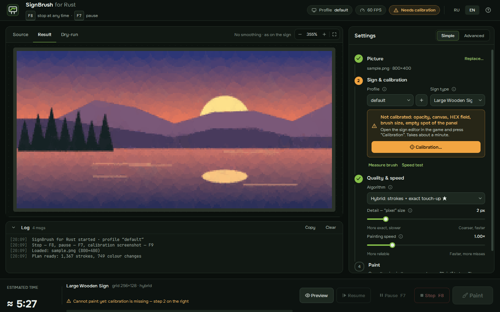

# SignBrush for Rust

**[Русская версия →](README.md)**

A free (MIT) Windows program that puts any picture onto a sign or picture frame in the game **Rust**. It paints the picture with the mouse in the in-game sign editor, the same way a person would, only faster and more precisely.


*The demo is a dry-run: the stroke order rendered by the program without touching the mouse.*



## Features

- **Three algorithms:** hybrid (strokes + exact touch-up), pixel-exact copy, and painterly translucent strokes.
- **Any colour, exactly:** colours are typed into the editor's HEX field. A picker mode (2 clicks on the colour square) and favourite swatches are also supported.
- **Calibration on a frozen screenshot:** about a minute, once per screen resolution. No calibration click ever reaches the game.
- **Brush measurement and speed test.** The program measures the in-game brush and finds the shortest safe pause for your FPS.
- **Verification:** after painting it screenshots the canvas and repaints missed cells.
- **Transparency:** transparent areas and margins can be filled with a background colour or skipped.
- **Pause, stop and resume.** F7 pauses, F8 stops at any moment. Progress is saved and can be resumed.
- **Interface in Russian and English.** Switch it with **RU | EN** in the top-right corner; the choice is remembered.

## Three algorithms

| | Hybrid (default) | Pixels | Strokes only |
|---|---|---|---|
| How | Coarse to fine: ~1000 semi-transparent strokes lay a smooth base, then a square brush repaints only the cells whose colour is still off by more than the tolerance | Every grid cell gets exactly its own colour | The picture is made only of semi-transparent circles ("primitive" approach), one click per stroke |
| Result | Almost as exact as pixels, about twice as fast | Exact copy (k-means palette fitted to the picture) | Soft, painterly picture |
| Calibration needed | canvas, HEX field, size and opacity | canvas, HEX field, size | canvas, HEX field, size and opacity |

Time and accuracy guide for an XL frame 512×512 (photo, 256×256 grid, program estimate). ΔE is the mean colour error in CIELAB; around 2 is barely visible:

| Mode | 60 FPS | 144 FPS | ΔE |
|---|---|---|---|
| Hybrid, HEX 48 colours, 1000 strokes, tolerance 8 | ~6.5 min | ~3 min | 2.5 |
| Pixels, HEX 48 colours | ~13 min | ~5.5 min | 2.3 |
| Strokes only, 6000 | ~10 min | ~4.5 min | 3.3 |


The game reads the mouse once per frame, so delays are counted in **game frames**. Enter your FPS: the higher it is, the faster the painting. Time depends mostly on the number of separate colour runs in the picture, not on its size. That is why the hybrid wins: smooth areas are covered by strokes, and exact touch-up is needed only in the details.

## Safety and fair play

- **Only** screen capture (`mss`) and mouse/keyboard emulation through `SendInput` are used. No game memory reading or writing, no injection, no hooks into the game process, no drivers, no anti-cheat bypass.
- **F8, the emergency stop, always works.** The hotkeys are read by polling `GetAsyncKeyState` (no global keyboard hook). Every wait in the executor can be interrupted, so stopping takes milliseconds, even mid-stroke, and the mouse button is released immediately.
- If you move the mouse or the Rust window loses focus, painting pauses by itself.
- No player tracking, no account data, no network access at all.

## Installation

**Prebuilt exe:** download `SignBrush.exe` from Releases (built by GitHub Actions) and run it. Settings are saved to `config.json` next to the exe (or to `%APPDATA%\SignBrush` if that folder is read-only).

**From source** (Python 3.11+):

```bash
pip install -r requirements.txt
```

```bash
python -m signbrush
```

## Quick start

1. Run Rust in **Borderless** or windowed mode. Program windows may not appear above exclusive fullscreen.
2. Drop a picture into the SignBrush window (or paste it with Ctrl+V).
3. Open the sign editor in the game, click **Calibration…** and press **F9** (or use "Screenshot in 5 s"). Mark up the screenshot as described below.
4. Click **Measure brush** once: the program paints two test dots in a corner of the canvas, measures them on a screenshot and erases them with Ctrl+Z.
5. Click **Speed test**: it paints a few zig-zags and dots, checks them and picks the pause for your FPS.
6. Check **Result** and **Dry-run**, tune the algorithm and detail. The time estimate updates right away.
7. Click **Paint**, switch to the game during the countdown and **do not touch the mouse**. F7 pauses, F8 stops; "Resume" continues an interrupted run.

## Calibration

The program captures the screen with the editor open and shows it full-screen; you mark it with the mouse, step by step, with hints on screen.

| Step | What to do | Required |
|---|---|---|
| Canvas | Drag a rectangle around the drawing area. **A** finds it automatically | yes |
| HEX field | Click the colour code field | for HEX input |
| Colour square and hue bar | Mark the colour picker | for picker mode |
| Size, opacity, spacing | Click the number next to each slider (or mark the slider) | size — yes |
| Square / round brush | Brush tip buttons | no |
| Favourites | From the centre of the first swatch to the centre of the last | no |
| Save | Save button (not pressed while painting by default) | no |
| Focus | An empty spot of the editor panel, used to confirm typed values. **Not on the canvas!** | yes |

Overlay keys: **Enter** — next, **Backspace** — erase the mark, **right click** — back, **S/Space** — skip an optional step, **arrows** — nudge the last point by 1 px (Shift: 10 px), **Esc** — cancel. A ×8 magnifier next to the cursor shows coordinates and the pixel colour.

**Profiles.** Coordinates depend on screen resolution and UI scale, so they are stored per profile. The `+` button creates a new profile as a copy of the current one.

## Dry-run and command line

The **Dry-run** tab in the GUI replays the stroke plan without the mouse. The same from a console:

```bash
python -m signbrush dryrun picture.png --sign sign.large.wood --detail 2 --gif plan.gif
```

Options: `--algorithm hybrid|pixels|shapes`, `--shapes N`, `--mode palette|hex`, `--colors N`, `--dither`, `--fit pad|crop|stretch`, `--shape square|circle`, `--fill-size N`, `--config path`.

## Build and tests

```bash
pip install -r requirements-dev.txt
```

```bash
python -m pytest
```

```bash
pyinstaller --noconfirm SignBrush.spec
```

GitHub Actions (`.github/workflows/build.yml`) runs the tests on every push, builds `SignBrush.exe`, smoke-tests its dry-run and uploads it as an artifact. A `v*` tag also creates a release. The README images are regenerated with `scripts/make_docs.py` and `scripts/make_ui_shots.py`.

Layout:

- `imaging`: quantization and dithering
- `planner`, `shapes`, `pipeline`: stroke plans, simulation and time estimate
- `calibration`: steps and canvas auto-detection
- `executor`, `verify`: input, pause/stop, progress, measurement and verification
- `gui`: the PyQt6 interface; `i18n`: Russian/English strings
- `winput`: SendInput and hotkeys; `screen`: mss

## Limitations and risks

- **Use at your own risk.** Input automation may break the rules of a particular server or of the game. The program is not approved by Facepunch Studios or the Easy Anti-Cheat team, and there are **no guarantees about anti-cheat or bans**. Check the server rules first.
- The sign editor UI changes between patches. If clicks stop landing, recalibrate.
- Do not touch the mouse or keyboard while painting. Raise the delays if the server lags.
- Screenshot verification can be confused by heavy post-processing or overlapping windows, which is why the number of passes is limited.
- The software is provided "as is", without warranty of any kind (see the licence).

## Disclaimer

SignBrush for Rust is an independent fan project. It is **not affiliated with, endorsed or sponsored by Facepunch Studios**. "Rust" is a trademark of Facepunch Studios Ltd. and is used here only to describe which game the program works with. The repository contains no game assets.

## Acknowledgements

The strokes mode follows the idea of the "primitive" generator (Michael Fogleman); the implementation is our own, vectorised with numpy. The design was checked against the open-source projects [Bob-Rust](https://github.com/Bob-Rust/Bob-Rust-Java) (MIT) and [RustDaVinci](https://github.com/alexemanuelol/rustdavinci) (GPL-3.0); their code is not used. Approximate sign texture sizes and default palette values come from Bob-Rust's published measurements.

Fonts: [Onest](https://github.com/googlefonts/onest) and [JetBrains Mono](https://github.com/JetBrains/JetBrainsMono), both under the SIL Open Font License 1.1 (texts in `signbrush/gui/fonts`).

## License

[MIT](LICENSE)
