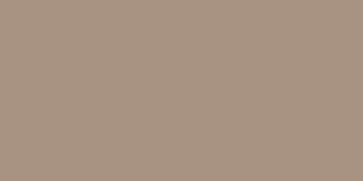
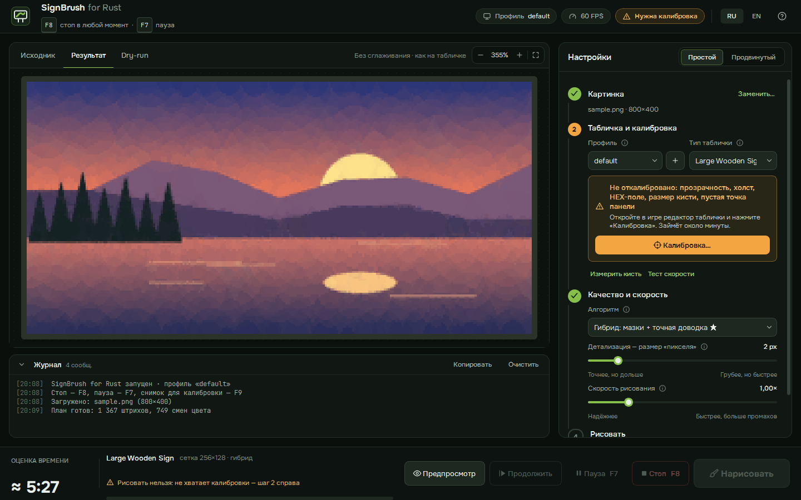
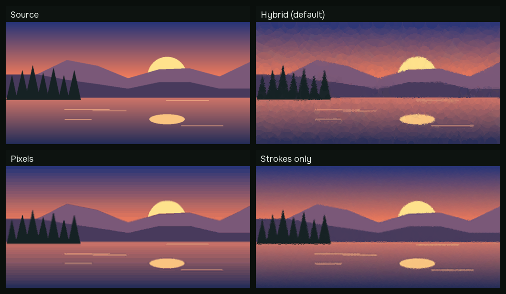

# SignBrush for Rust

**[English version →](README.en.md)**

Свободная (MIT) программа для Windows, которая переносит любую картинку на табличку или рамку в игре **Rust**. Она рисует картинку мышью в игровом редакторе табличек — так же, как это делал бы человек, только быстрее и точнее.



*Демо — это dry-run: порядок штрихов, отрисованный программой без управления мышью.*



## Возможности

- **Три алгоритма:** гибрид (мазки + точная доводка), точная попиксельная копия и живописные полупрозрачные мазки.
- **Любой цвет точно:** цвета вводятся в HEX-поле редактора. Есть и режим пипетки (2 клика по цветовому квадрату), и клики по избранным цветам.
- **Калибровка на замороженном снимке:** около минуты, один раз на разрешение экрана. Ни один клик калибровки не попадает в игру.
- **Измерение кисти и тест скорости.** Программа сама меряет кисть в игре и подбирает минимальную безопасную паузу под ваш FPS.
- **Проверка:** после рисования программа делает снимок холста и дорисовывает пропущенные клетки.
- **Прозрачность:** прозрачные места и поля можно залить цветом фона или не рисовать вовсе.
- **Пауза, стоп и продолжение.** F7 — пауза, F8 — стоп в любой момент. Прогресс сохраняется, рисование можно продолжить.
- **Интерфейс на русском и английском.** Переключатель **RU | EN** в правом верхнем углу, выбор запоминается.

## Три алгоритма

| | Гибрид (по умолчанию) | Попиксельно | Только мазки |
|---|---|---|---|
| Как | От крупного к мелкому: ~1000 полупрозрачных мазков кладут плавную основу, затем квадратная кисть дорисовывает только клетки, где цвет ещё отличается сильнее допуска | Каждая клетка сетки получает ровно свой цвет | Картина только из полупрозрачных кругов (подход «primitive»), один клик на мазок |
| Результат | Почти как попиксельно, но вдвое быстрее | Точная копия (k-means-палитра под картинку) | Мягкая «живописная» картинка |
| Нужно откалибровать | холст, HEX-поле, размер и прозрачность | холст, HEX-поле, размер | холст, HEX-поле, размер и прозрачность |

Ориентир по времени и точности для XL-рамки 512×512 (фото, сетка 256×256, оценка программы). ΔE — средняя цветовая ошибка в CIELAB, около 2 на глаз почти незаметно:

| Режим | 60 FPS | 144 FPS | ΔE |
|---|---|---|---|
| Гибрид, HEX 48 цветов, 1000 мазков, допуск 8 | ~6,5 мин | ~3 мин | 2,5 |
| Попиксельно, HEX 48 цветов | ~13 мин | ~5,5 мин | 2,3 |
| Только мазки, 6000 | ~10 мин | ~4,5 мин | 3,3 |



Игра читает мышь раз в кадр, поэтому задержки считаются в **кадрах игры**. Укажите свой FPS: чем он выше, тем быстрее рисование. Время в основном определяется числом отдельных цветовых участков картинки, а не её размером. Поэтому гибрид и выигрывает: плавные области закрываются мазками, а точная доводка нужна только в деталях.

## Безопасность и честность

- Используется **только** захват экрана (`mss`) и эмуляция мыши/клавиатуры через `SendInput`. Нет чтения или записи памяти игры, инъекций, хуков в процесс игры, драйверов и обхода античита.
- **F8 — аварийная остановка — работает всегда.** Горячие клавиши читаются опросом `GetAsyncKeyState`, без глобального хука клавиатуры. Все ожидания исполнителя прерываемые, поэтому остановка срабатывает за миллисекунды, даже посреди штриха, и кнопка мыши сразу отпускается.
- Если вы сдвинули мышь или окно Rust перестало быть активным, рисование само встаёт на паузу.
- Никакой слежки за игроками, сбора данных аккаунтов и сетевых запросов. Программа вообще не ходит в сеть.

## Установка

**Готовый exe:** скачайте `SignBrush.exe` со страницы Releases (собирается GitHub Actions) и запустите. Настройки сохраняются в `config.json` рядом с exe (или в `%APPDATA%\SignBrush`, если папка только для чтения).

**Из исходников** (Python 3.11+):

```bash
pip install -r requirements.txt
```

```bash
python -m signbrush
```

## Быстрый старт

1. Запустите Rust в режиме окна **«Без рамки» (Borderless)** или в окне: поверх эксклюзивного полноэкранного режима окна программы могут не показываться.
2. Перетащите картинку в окно SignBrush (или вставьте её через Ctrl+V).
3. Откройте в игре редактор таблички, нажмите **«Калибровка…»** и затем **F9** (или «Снимок через 5 с»). Разметьте снимок (см. ниже).
4. Один раз нажмите **«Измерить кисть»**: программа поставит две пробные точки в углу холста, измерит их по скриншоту и сотрёт через Ctrl+Z.
5. Нажмите **«Тест скорости»**: программа нарисует несколько зигзагов и точек, проверит их и подберёт паузу под ваш FPS.
6. Посмотрите **«Результат»** и **Dry-run**, подберите алгоритм и детализацию. Оценка времени обновляется сразу.
7. Нажмите **«Нарисовать»**, за время отсчёта переключитесь в игру и **не трогайте мышь**. F7 — пауза, F8 — стоп; «Продолжить» возобновляет прерванное рисование.

## Калибровка

Программа делает снимок экрана с открытым редактором и показывает его на весь экран, а вы по шагам размечаете его мышью — подсказки видны прямо на снимке.

| Шаг | Что сделать | Обязательно |
|---|---|---|
| Холст | Обвести рамкой область рисования. **A** — найти автоматически | да |
| HEX-поле | Кликнуть в поле кода цвета | для HEX-ввода |
| Квадрат и полоса цвета | Отметить цветовой квадрат и полосу тонов | для пипетки |
| Размер, прозрачность, интервал | Кликнуть по числу справа от каждого ползунка (или отметить сам ползунок) | размер — да |
| Квадратная / круглая кисть | Кнопки формы кисти | нет |
| Избранное | От центра первого образца до центра последнего | нет |
| Сохранить | Кнопка сохранения (по умолчанию во время рисования не нажимается) | нет |
| Фокус | Пустое место панели редактора: кликом туда программа подтверждает введённые значения. **Не на холсте!** | да |

Клавиши в оверлее: **Enter** — дальше, **Backspace** — стереть метку, **ПКМ** — шаг назад, **S/Пробел** — пропустить необязательный шаг, **стрелки** — сдвинуть последнюю точку на 1 px (с Shift — на 10), **Esc** — отмена. Рядом с курсором — лупа ×8 с координатами и цветом пикселя.

**Профили.** Координаты зависят от разрешения экрана и масштаба UI, поэтому они хранятся в профилях. Кнопка `+` создаёт новый профиль как копию текущего.

## Dry-run и командная строка

В GUI вкладка **Dry-run** проигрывает план штрихов без мыши. То же из консоли:

```bash
python -m signbrush dryrun picture.png --sign sign.large.wood --detail 2 --gif plan.gif
```

Опции: `--algorithm hybrid|pixels|shapes`, `--shapes N`, `--mode palette|hex`, `--colors N`, `--dither`, `--fit pad|crop|stretch`, `--shape square|circle`, `--fill-size N`, `--config путь`.

## Сборка и тесты

```bash
pip install -r requirements-dev.txt
```

```bash
python -m pytest
```

```bash
pyinstaller --noconfirm SignBrush.spec
```

GitHub Actions (`.github/workflows/build.yml`) на каждом push гоняет тесты, собирает `SignBrush.exe`, проверяет его dry-run и выкладывает как артефакт; на тег `v*` создаёт релиз. Картинки для README пересоздаются скриптами `scripts/make_docs.py` и `scripts/make_ui_shots.py`.

Структура:

- `imaging`: квантование и дизеринг
- `planner`, `shapes`, `pipeline`: планы штрихов, симуляция, оценка времени
- `calibration`: шаги и автопоиск холста
- `executor`, `verify`: ввод, пауза/стоп, прогресс, измерения и проверка
- `gui`: интерфейс на PyQt6; `i18n`: строки на русском и английском
- `winput`: SendInput и горячие клавиши; `screen`: mss

## Ограничения и риски

- **Используйте на свой риск.** Автоматизация ввода может нарушать правила конкретного сервера или игры. Программа не одобрена Facepunch Studios и разработчиками Easy Anti-Cheat, и **никаких гарантий насчёт античита и банов нет**. Перед использованием уточните правила сервера.
- Интерфейс редактора табличек меняется от патча к патчу. Если клики перестали попадать — перекалибруйте.
- Не трогайте мышь и клавиатуру во время рисования. При лагах сервера увеличьте задержки.
- Сильная постобработка или наложенные окна могут сбивать проверку по скриншоту, поэтому число проходов ограничено.
- Программа поставляется «как есть», без каких-либо гарантий (см. лицензию).

## Отказ от ответственности

SignBrush for Rust — независимый фанатский проект. Он **не связан с Facepunch Studios, не одобрен и не спонсируется ею**. «Rust» — товарный знак Facepunch Studios Ltd.; название игры используется только чтобы указать, с какой игрой работает программа. В репозитории нет игровых ассетов.

## Благодарности

Режим мазков следует идее генератора «primitive» (Michael Fogleman); реализация своя, векторизованная на numpy. Идеи сверены с open-source проектами [Bob-Rust](https://github.com/Bob-Rust/Bob-Rust-Java) (MIT) и [RustDaVinci](https://github.com/alexemanuelol/rustdavinci) (GPL-3.0); их код не используется. Приблизительные размеры текстур табличек и цвета палитры по умолчанию взяты из открытых замеров Bob-Rust.

Шрифты: [Onest](https://github.com/googlefonts/onest) и [JetBrains Mono](https://github.com/JetBrains/JetBrainsMono), оба под SIL Open Font License 1.1 (тексты лицензий — в `signbrush/gui/fonts`).

## Лицензия

[MIT](LICENSE)
